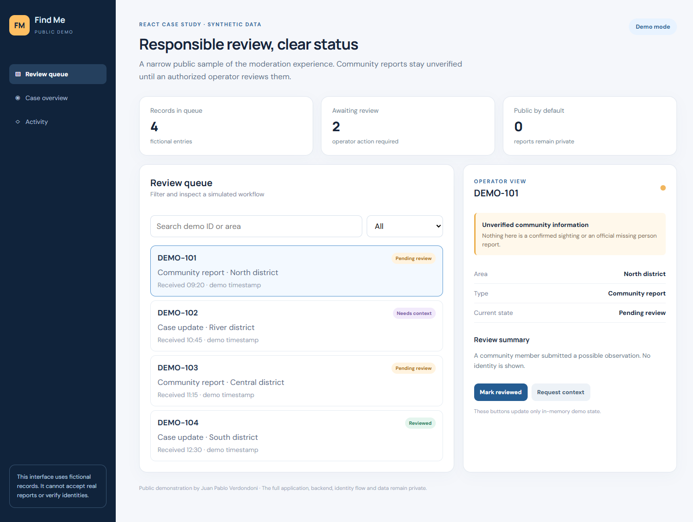

# Find Me · public React demo



An isolated, runnable **React + Vite** case study based on the review workflow of my private Find Me project. It demonstrates component composition, controlled inputs, memoized filtering, state transitions and a privacy conscious interface.

The full academic application uses React on the frontend, Java/Spring Boot on the backend and PostgreSQL/PostGIS. This repository contains **no backend, real reports, photos, coordinates, identity records, integration keys or original production source**. Every displayed record is fictional. This demo cannot accept reports or verify identities.

Find Me is a complementary academic tool; it is not an official missing person reporting channel. Community observations must never be presented as confirmed sightings before appropriate review.

## Run

```bash
npm install
npm run dev
```

Run the public demo tests with `npm test` and verify the production bundle with `npm run build`. These checks cover this repository's visible React workflow only; they do not claim coverage of the private Java backend or the full Find Me application.

## Documentation

The [documentation index](docs/00-indice/INDICE.md) links the public specification, design (SDD), implementation plan, decisions, user walkthrough and test strategy. Its scope is deliberately limited to this standalone demo; it follows the organization of the full project's documentation without copying private specifications.

## What to inspect

- `src/App.jsx`: filtering and review state in React.
- `src/styles.css`: responsive layout and distinct status treatments.
- The UI makes the demo and unverified status visible throughout the flow.

**Scope:** This repo is a deliberately limited public sample, not the complete product. Designed and implemented by Juan Pablo Verdondoni.

Copyright © Juan Pablo Verdondoni. No reuse license is granted for this public sample.
