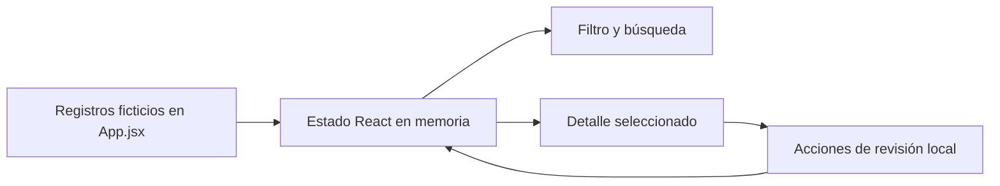

# SDD · Demo React de revisión

**Estado:** etapa inicial implementada. El recorrido público conectado actual está descrito en el [SDD 003](../003-connected-public-sample/sdd.md). Este texto conserva las decisiones de aquella etapa React aislada.

## 1. Contexto y límites

La aplicación es una SPA React/Vite autónoma. El navegador renderiza una cola ficticia y conserva los cambios sólo mientras la página permanece cargada. No hay API, base de datos, sesión de usuario ni servicio externo. El flujo público se centra en el juicio de presentación: un registro comunitario queda identificado como no verificado incluso cuando un operador ficticio interactúa con él.

## 2. Modelo de datos publicado

Cada entrada tiene `id`, `area`, `category`, `status`, `received` y `detail`. Los identificadores `DEMO-*` y las áreas genéricas son inventados. `status` toma `Pending review`, `Needs context` o `Reviewed`. No existe un campo para identidad o coordenadas. El conjunto inicial contiene cuatro entradas y permanece en el bundle; no se descarga información.

## 3. Estado y responsabilidades

`records` conserva los cambios; `filter` y `query` controlan la lista; `selected` identifica el detalle. `visible` se deriva con `useMemo` combinando estado y texto normalizado a minúsculas. `pending` cuenta los `Pending review` del conjunto completo, no sólo de la vista filtrada. `changeStatus` reemplaza únicamente el elemento cuyo `id` coincide con `selected`.

La selección puede continuar visible en el panel de detalle aunque el filtro retire ese registro de la lista. Es una decisión de interacción de esta muestra; el filtro restringe la cola, no el detalle ya seleccionado.

## 4. Flujo principal y fallos previstos

1. La persona filtra o busca; la lista se recalcula sin mutar los registros.
2. Selecciona una entrada; el panel muestra área, tipo, estado y resumen ficticio.
3. Solicita contexto o marca revisada; sólo cambia el estado local del registro seleccionado.
4. Si la combinación de controles no coincide, la cola muestra un mensaje explícito.

No hay confirmación externa de una acción ni publicación. La cifra `Public by default` es cero constante y representa la política de esta demo, no un contador de producción.

## 5. Trazabilidad

| Requisito | Implementación | Prueba pública |
| --- | --- | --- |
| FM-01, FM-04 | Semilla, métricas y advertencia en `App.jsx` | `starts with fictional...` |
| FM-02 | `visible` y controles | `search and status filter...` |
| FM-03 | `selected`, `changeStatus`, `pending` | `review changes...`, `requesting context...` |
| FM-05 | Vite, Vitest y workflow | `npm test`, `npm run build` |

## 6. Riesgos y alcance de evidencia

Una UI sin backend no demuestra autorización, moderación real, protección de datos, trazabilidad legal ni calidad del sistema completo. El SDD usa nombres genéricos y no incluye reglas internas, esquemas privados, endpoints o casos reales.
